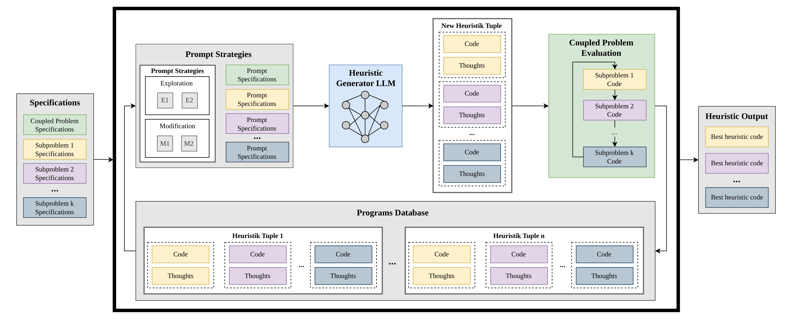
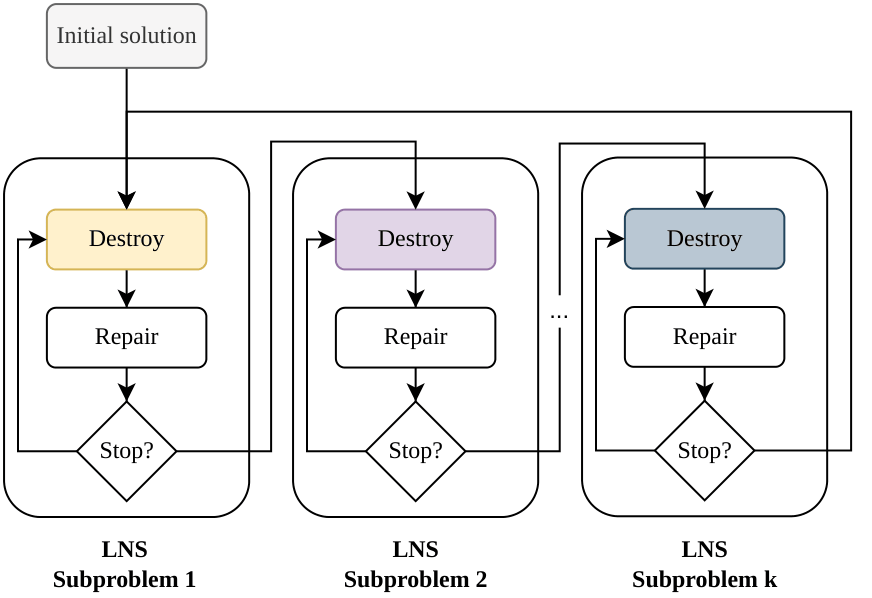

# CoupleEvo: Evolving Heuristics for Coupled Optimization Problems Using Large Language Models

This repository contains complementary material for the paper "CoupleEvo: Evolving Heuristics for Coupled Optimization Problems Using Large Language Models".

The repository includes:
 - Prompt templates
 - Code of the best performing heuristic tuples
 - Full source code **(will be published on acceptance of the paper)**

<p align="center">
  
</p>
<p align="left">
  <em>Figure: CoupleEvo evolves multiple heuristics for coupled optimization problems.</em>
</p>

The main contributions of this work are summarized as follows:

- **CoupleEvo:** We formulate the first LLM-driven framework for automated heuristic design in coupled optimization problems, extending existing single-problem approaches to settings with multiple interdependent NP-hard subproblems.

- **Evolutionary Strategies:** 
We propose three evolutionary coordination strategies - *Sequential Evolution*,*Iterative Evolution*,and *Integrated Evolution*.
These strategies govern how heuristics for interacting subproblems are generated within the evolutionary process.

- **Comprehensive Evaluation:** We conduct extensive experimental evaluations on two representative coupled optimization domains:
Inventory Routing Problem (IRP)
Multi-robot Multi-bay Unit-Load Pre-Marshalling Problem (MR-MUPMP)  

For details, we refer to the paper.


## Prompt Templates

## Best Performing Heuristic Tuples
This section presents the best-performing heuristic tuples evolved by **CoupleEvo** for the studied coupled optimization problems. Each heuristic represents a learned strategy for modifying intermediate solutions and is expressed as executable code.
The heuristics are designed to operate within an alternating Large Neighborhood Search (LNS) framework, where they guide the exploration of the solution space by selectively removing and reshaping parts of a current solution. The code shown below can be directly integrated into such an optimization pipeline.


### How the Heuristics Are Used in LNS

The provided heuristics are designed as **destroy operators** within an alternating LNS framework for coupled optimization problems.

Each subproblem is associated with its own LNS module. During the search process:

1. The current solution is passed to the active subproblem.
2. The **LLM-generated destroy heuristic** selectively removes parts of the solution (e.g., shipments, customers, or moves).
3. A fixed, problem-specific **repair operator** reconstructs a feasible solution.
4. The improved solution is then passed to the next subproblem.

This process alternates between subproblems until a global stopping criterion is reached.

The key idea is that the destroy heuristics control **which parts of the solution are evolved**, thereby guiding the search toward promising regions. Since the subproblems are tightly coupled, improvements in one subproblem influence the solution quality of the others.

The code snippets in this repository correspond to these destroy operators and can be directly plugged into an LNS loop following this structure.

<p align="center">
  
</p>
<p align="left">
  <em>Figure: The LLM generates a destroy function for an alternating LNS framework. The LLM-generated parts are colored.</em>
</p>

The best performing heuristic code  for each studied coupled optimization problem is displayed below.

### Inventory Routing Problem
<details>
<summary><strong>Destroy Operator IRP: Inventory Subproblem (click to expand)</strong></summary>

```python
# This algorithm scores shipment elements based on their contribution to capacity violations,
# inventory penalties, and route inefficiency. It prioritizes removing elements that cause
# the most severe violations or penalties, while incorporating randomized diversification
# and applying a conservative destruction rate.

def destroy_scoring(solution, data, rng):
    shipments = solution['shipments']
    routes = solution['routes']
    T, V, N = shipments.shape
    
    # Initialize scores
    scores = [[[0.0 for _ in range(N)] for _ in range(V)] for _ in range(T)]
    
    # Calculate inventory levels
    cust_inv = np.zeros((N, T))
    depot_inv = np.zeros(T)
    cust_inv[:, 0] = data['cust_I0']
    depot_inv[0] = data['depot_I0']
    
    # Calculate inventory levels for each period
    for t in range(T):
        if t > 0:
            cust_inv[:, t] = cust_inv[:, t-1] - data['cust_demand'][:, t-1]
            depot_inv[t] = depot_inv[t-1] + data['depot_prod'][t-1] - np.sum(data['cust_demand'][:, t-1])
        
        # Add shipments to inventory
        for v in range(V):
            for i in range(N):
                cust_inv[i, t] += shipments[t, v, i]
                depot_inv[t] -= shipments[t, v, i]
    
    # Calculate penalties for inventory violations
    cust_violation = np.zeros((N, T))
    depot_violation = np.zeros(T)
    
    for t in range(T):
        for i in range(N):
            if cust_inv[i, t] < 0:
                cust_violation[i, t] = -cust_inv[i, t] * data['cust_inv_cost'][i] * 15  # shortage penalty
            elif cust_inv[i, t] > data['cust_Lmax'][i]:
                cust_violation[i, t] = (cust_inv[i, t] - data['cust_Lmax'][i]) * data['cust_inv_cost'][i] * 5  # excess penalty
        
        if depot_inv[t] < 0:
            depot_violation[t] = -depot_inv[t] * data['depot_inv_cost'] * 15
        elif depot_inv[t] > data['depot_I0'] * 10:
            depot_violation[t] = (depot_inv[t] - data['depot_I0'] * 10) * data['depot_inv_cost'] * 5
    
    # Calculate travel costs
    travel_costs = np.zeros((T, V))
    for t in range(T):
        for v in range(V):
            if t in routes and v in routes[t]:
                route = routes[t][v]
                total_cost = 0
                prev_node = 0  # depot
                
                for customer, quantity in route:
                    total_cost += data['cost_matrix'][prev_node][customer + 1]
                    prev_node = customer + 1
                
                total_cost += data['cost_matrix'][prev_node][0]
                travel_costs[t, v] = total_cost
    
    # Score each shipment element
    for t in range(T):
        for v in range(V):
            for i in range(N):
                if shipments[t, v, i] > 0:
                    violation_cost = cust_violation[i, t] + depot_violation[t]
                    travel_cost = travel_costs[t, v]
                    
                    score = violation_cost + travel_cost
                    
                    # Randomization for diversification
                    score *= rng.uniform(0.5, 1.5)
                    
                    # Quantity-based adjustments
                    score += shipments[t, v, i] * 0.05
                    score += shipments[t, v, i] * 0.08
                    
                    scores[t][v][i] = score
    
    # Conservative destruction size (1–3%)
    non_zero_count = np.count_nonzero(shipments)
    k = max(1, min(3, int(non_zero_count * 0.03)))
    
    return scores, k
```
</details>


<details>
<summary><strong>Destroy Operator IRP: Vehicle Routing Subproblem (click to expand)</strong></summary>

```python
# This algorithm scores customers using a "supply chain vulnerability index" that
# combines inventory risk exposure, demand-supply mismatch, and route isolation
# metrics. It prioritizes customers whose removal would most significantly disrupt
# supply chain stability and operational efficiency.

def destroy_scoring(day_routes, data, rng):
    N = data['N']
    T = data['T']
    cost_matrix = data['cost_matrix']
    cust_demand = data['cust_demand']
    cust_I0 = data['cust_I0']
    cust_Lmax = data['cust_Lmax']
    cust_inv_cost = data['cust_inv_cost']
    
    # Inventory risk exposure (proximity to capacity limit)
    inventory_risk = np.zeros(N)
    for i in range(N):
        if cust_Lmax[i] > 0:
            inventory_risk[i] = 1.0 - (cust_I0[i] / cust_Lmax[i])
    
    # Demand-supply mismatch
    demand_mean = np.mean(cust_demand, axis=1)
    supply_demand_mismatch = np.zeros(N)
    for i in range(N):
        if demand_mean[i] > 0:
            supply_demand_mismatch[i] = abs(cust_I0[i] - demand_mean[i]) / (demand_mean[i] + 1e-8)
    
    # Route isolation (number of vehicles serving each customer)
    vehicle_count = np.zeros(N)
    for v, route in day_routes.items():
        if not route:
            continue
        for cust_idx, _ in route:
            vehicle_count[cust_idx] += 1
    
    # Route efficiency impact (cost change if customer is removed)
    customer_route_impact = np.zeros(N)
    for v, route in day_routes.items():
        if not route:
            continue
        for i, (cust_idx, _) in enumerate(route):
            if len(route) <= 1:
                continue
            
            cost_without = 0
            if i > 0:
                cost_without += cost_matrix[route[i-1][0] + 1][cust_idx + 1]
            if i < len(route) - 1:
                cost_without += cost_matrix[cust_idx + 1][route[i+1][0] + 1]
            
            cost_with = 0
            if i > 0 and i < len(route) - 1:
                cost_with += cost_matrix[route[i-1][0] + 1][route[i+1][0] + 1]
            
            customer_route_impact[cust_idx] += (cost_without - cost_with)
    
    # Normalize by vehicle count
    vehicle_count = np.maximum(vehicle_count, 1)
    customer_route_impact /= vehicle_count
    
    # Weighted vulnerability score
    weights = np.array([0.4, 0.3, 0.3])
    scores = np.zeros(N)
    scores += weights[0] * inventory_risk
    scores += weights[1] * supply_demand_mismatch
    scores += weights[2] * customer_route_impact
    
    # Rank customers by score
    score_list = [(i, float(scores[i])) for i in range(N)]
    score_list.sort(key=lambda x: x[1], reverse=True)
    
    # Adaptive destruction size
    k = max(1, min(N // 4, int(rng.integers(1, N // 3 + 1))))
    
    return score_list, k
```

</details>

### Multi-robot Multi-bay Premarshalling Problem

<details>
<summary><strong>Destroy Operator MR-MUPMP: Move Search Subproblem (click to expand)</strong></summary>

```python
# This algorithm scores access points based on their dependency centrality and
# spatial isolation. It prioritizes removing elements that are most critical for
# maintaining solution feasibility, targeting high-dependency points that constrain
# A* exploration and maximizing search space reduction.

def destroy_scoring(current_solution, data, rng):
    # Initialize scores and tracking
    scores = []
    ap_dependencies = {ap: 0 for move in current_solution for ap in move}
    ap_isolation = {ap: 0 for move in current_solution for ap in move}
    
    # Calculate dependency counts
    for move_idx, move in enumerate(current_solution):
        pickup = move[0]
        dropoff = move[1]
        
        for dep_type in ['equal_prio', 'unequal_prio']:
            if dep_type in data.move_dependencies:
                for dep_subtype in ['end-end', 'start-end', 'end-start', 'start-start']:
                    if dep_subtype in data.move_dependencies[dep_type]:
                        for dep in data.move_dependencies[dep_type][dep_subtype]:
                            if move_idx in dep:
                                ap_dependencies[pickup] += 1
                                ap_dependencies[dropoff] += 1
    
    # Calculate spatial isolation
    ap_positions = {ap: [] for move in current_solution for ap in move}
    for i, move in enumerate(current_solution):
        pickup = move[0]
        dropoff = move[1]
        ap_positions[pickup].append(i)
        ap_positions[dropoff].append(i)
    
    ap_isolation_scores = {}
    for ap in ap_positions:
        distances = []
        for other_ap in ap_positions:
            if other_ap != ap:
                dist = data.ap_distance[ap, other_ap]
                distances.append(dist)
        if distances:
            avg_dist = np.mean(distances)
            ap_isolation_scores[ap] = 1 / (avg_dist + 1)
        else:
            ap_isolation_scores[ap] = 0
    
    # Score each move
    for i, move in enumerate(current_solution):
        pickup = move[0]
        dropoff = move[1]
        
        pu_deps = ap_dependencies[pickup]
        do_deps = ap_dependencies[dropoff]
        
        pu_isolation = ap_isolation_scores[pickup]
        do_isolation = ap_isolation_scores[dropoff]
        
        seq_bonus = rng.random() * i * 0.05
        
        sp = (rng.random() * 0.02
              + seq_bonus
              + pu_deps * 0.03
              + pu_isolation * 0.02)
        
        sd = (rng.random() * 0.03
              + data.ap_distance[pickup, dropoff] * 0.05
              + seq_bonus
              + do_deps * 0.02
              + do_isolation * 0.015)
        
        scores.append([sp, sd])
    
    # Remove 25% of elements
    k = int(np.ceil(0.25 * len(current_solution)))
    
    return scores, k
```

</details>

<details>
<summary><strong>Destroy Operator MR-MUPMP: Vehicle Routing Subproblem (click to expand)</strong></summary>

```python
# This algorithm scores moves based on their contribution to overall solution entropy
# and access point diversity. It prioritizes removing moves that reduce the system's
# ability to maintain balanced and varied access point usage patterns.

def destroy_scoring(current_solution, data, rng):
    # Flatten current solution to get all moves
    all_moves = []
    for robot_moves in current_solution:
        all_moves.extend(robot_moves)
    
    # Initialize scores
    scores = []
    
    # Calculate access point usage statistics
    ap_usage_count = {}
    ap_robot_usage = {}
    
    for move in all_moves:
        move_id = move['id']
        if move_id == 0:
            scores.append((move_id, float('-inf')))
            continue
            
        pickup_ap = move['move'][0]
        dropoff_ap = move['move'][1]
        
        # Count access point usage
        ap_usage_count[pickup_ap] = ap_usage_count.get(pickup_ap, 0) + 1
        ap_usage_count[dropoff_ap] = ap_usage_count.get(dropoff_ap, 0) + 1
        
        # Track robot-specific usage
        robot_id = move['robot']
        if robot_id not in ap_robot_usage:
            ap_robot_usage[robot_id] = {}
        ap_robot_usage[robot_id][pickup_ap] = ap_robot_usage[robot_id].get(pickup_ap, 0) + 1
        ap_robot_usage[robot_id][dropoff_ap] = ap_robot_usage[robot_id].get(dropoff_ap, 0) + 1
    
    # Base entropy calculation
    entropy_base = 0.0
    for count in ap_usage_count.values():
        if count > 0:
            prob = count / len(all_moves)
            entropy_base -= prob * (prob if prob > 0 else 1)
    
    # Score each move
    for move in all_moves:
        move_id = move['id']
        if move_id == 0:
            continue
            
        pickup_ap = move['move'][0]
        dropoff_ap = move['move'][1]
        
        pickup_count = ap_usage_count[pickup_ap]
        dropoff_count = ap_usage_count[dropoff_ap]
        
        # Rarity score
        rarity_score = 1.0 / (1.0 + min(pickup_count, dropoff_count))
        
        # Robot balance score
        robot_id = move['robot']
        robot_ap_count = len(ap_robot_usage[robot_id])
        robot_avg_usage = (
            sum(ap_robot_usage[robot_id].values()) / robot_ap_count
            if robot_ap_count > 0 else 0
        )
        
        balance_score = 0.0
        if robot_avg_usage > 0:
            pickup_robot_usage = ap_robot_usage[robot_id][pickup_ap]
            dropoff_robot_usage = ap_robot_usage[robot_id][dropoff_ap]
            deviation = abs(pickup_robot_usage - robot_avg_usage) + abs(dropoff_robot_usage - robot_avg_usage)
            balance_score = 1.0 / (1.0 + deviation)
        
        # Dependency impact
        dependency_score = 0.0
        move_start = move['start_time']
        move_end = move['end_time']
        
        for dep_type in ['equal_prio', 'unequal_prio']:
            if dep_type in data.move_dependencies:
                for sub_type in ['end-end', 'start-end', 'end-start', 'start-start']:
                    if sub_type in data.move_dependencies[dep_type]:
                        for dep_pair in data.move_dependencies[dep_type][sub_type]:
                            if move_id in dep_pair:
                                other_id = dep_pair[1] if dep_pair[0] == move_id else dep_pair[0]
                                other_move = next((m for m in all_moves if m['id'] == other_id), None)
                                if other_move:
                                    other_start = other_move['start_time']
                                    other_end = other_move['end_time']
                                    overlap_start = max(move_start, other_start)
                                    overlap_end = min(move_end, other_end)
                                    if overlap_start < overlap_end:
                                        dependency_score += (overlap_end - overlap_start) * 0.5
        
        # Combine scores
        total_score = (
            rarity_score * 0.4 +
            balance_score * 0.3 +
            dependency_score * 0.3
        )
        
        # Add randomness
        total_score += rng.uniform(-0.2, 0.2)
        
        scores.append((move_id, total_score))
    
    # Sort descending
    scores.sort(key=lambda x: x[1], reverse=True)
    
    # Remove 10–25% of moves
    total_moves = len(all_moves)
    k = max(1, min(int(total_moves * 0.25), total_moves - 1))
    k = max(1, min(k + rng.integers(-3, 4), total_moves - 1))
    
    return scores, k
```
</details> 
